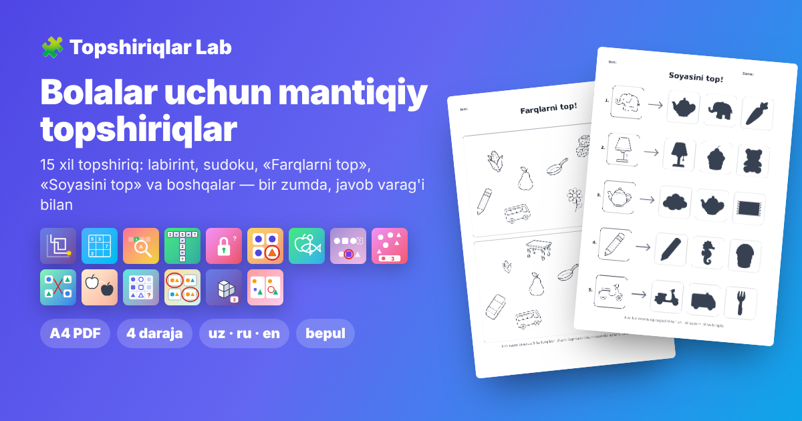

# Topshiriqlar Lab · Лаборатория заданий · Puzzle Lab

Bolalar uchun mantiqiy topshiriqlar generatori: **labirint, sudoku, so'z qidiruv, sonli krossvord, «Kodni top» va 10 ta vizual mantiq topshirig'i** («Ortiqchasini top», «Farqlarni top», «Soyasini top» va boshqalar).
Bir zumda yarating, javob varag'i bilan **A4 PDF** qilib chop eting. Bepul, ro'yxatdan o'tishsiz, internetsiz ham ishlaydi.

**Sayt:** https://umarxon7887.github.io/puzzle-lab/

[O'zbekcha](#ozbekcha) · [Русский](#русский) · [English](#english) 

---

## O'zbekcha

### Imkoniyatlar

- **15 ta generator**, har birida 4 ta daraja: Oson, O'rta, Qiyin, Juda qiyin.
  - **Labirint** — 8 xil shakl (to'rtburchak, doira, yulduz, yurak…), qahramon va manzil stikerlari, o'lchamni o'zingiz ham berishingiz mumkin.
  - **Sudoku** — 4×4 dan 9×9 gacha, diagonal (X) va shaklli bloklar (5×5, 7×7). Yechim har doim **yagona**; Oson va O'rta taxminsiz yechiladi.
  - **So'z qidiruv** — 11 ta mavzu (uch tilda) yoki o'zingiz yozgan so'zlar. Har bir so'z jadvalda **aynan bir marta** uchraydi. O'zbekcha **O‘** va **G‘** — bitta harf, bitta katakka yoziladi.
  - **Sonli krossvord** — kesishgan misollar (+, −, ×, ÷); har bir bo'sh katakcha mantiq bilan topiladi.
  - **Kodni top** — 3, 4 yoki 5 xonali kod va ishoralar; yechim yagona, ekranda javobni tekshirib ko'rish mumkin.
  - **Ortiqchasini top** — har qatorda bittasi boshqalariga o'xshamaydi: rasmlar (mevalar, hayvonlar, transport, kiyimlar…), shakllar (shakli, bo'yalishi, o'lchami, yo'nalishi, nuqtalar soni, ichki shakl, ko'zgu aksi) yoki aralash. Ortiqchasi har doim **bitta**; javob varag'ida nega ortiqchaligi yozilgan.
  - **Ustma-ust rasmlar** — 3 tadan 7 tagacha buyumning konturi bir-birining ustiga chizilgan; bola ularni topadi va nomini aytadi (ro'yxat bilan yoki ro'yxatsiz). Javob varag'ida har bir buyum o'z rangida. 189 ta rasm: mevalar, hayvonlar, transport, kiyim, uy buyumlari, o'yinchoqlar va milliy buyumlar (non, do'ppi, dutor, lagan…).
  - **Qonuniyatni davom ettir** — shakllar yoki rasmlar ketma-ketligida «?» o'rniga nima kelishini tanlash (AB, ABC, AABB, burilish, ko'payish).
  - **Yetishmayotgan qism** — 3×3 jadvaldagi qator va ustun qoidasini topib, bo'sh katakni to'ldirish.
  - **Farqlarni top** — ikki rasm orasidagi 3–9 ta farq (yo'q, qo'shilgan, almashgan, kichraygan, ko'zgudagi aksi, burilgan).
  - **Soyasini top** — rasmga aynan mos soyani tanlash yoki rasmlarni soyalari bilan tutashtirish; tuzoqlar: o'xshash siluetlar va ko'zgu aksi.
  - **Juftini top** — bir xil rasmlar, rasm va uning nomi yoki rasmlar soni va raqamni chiziq bilan tutashtirish.
  - **Ko'rib top va sana** — aralash rasmlar orasidan berilganlarini sanash.
  - **Aynan bir xil ikkitasi** — o'xshash kartochkalar orasidan to'liq bir xil ikkitasini topish.
  - **Kubiklarni sana** — izometrik kubiklar uyumi; qiyin darajalarda ko'rinmaydigan kubiklar ham bor.
- **To'plam** — turli generatorlardan aralash topshiriqlar: har turdan nechtadan kerakligini tanlang, ko'rib chiqing, keragini almashtiring yoki olib tashlang, so'ng **bitta PDF** (topshiriqlar, javoblar yoki ikkalasi) qilib oling.
- Bir varaqda **1, 2 yoki 4 ta** topshiriq (qirqish chiziqlari bilan), **ism va sana** uchun qator.
- Varaq tepasidagi matnni o'zgartirish va o'lchamini tanlash mumkin.
- **Topshiriq raqami**: bir xil raqam va sozlamalar har doim aynan bir xil topshiriqni beradi — raqamni yozib qo'ysangiz, keyin javobini ham topasiz. Raqam varaq pastida va fayl nomida ko'rsatiladi.
- **Uch til**: o'zbekcha, ruscha, inglizcha (sahifa yangilanmasdan almashadi).
- Telefonga ilova kabi o'rnatiladi va **internetsiz** ishlaydi.

### Qanday ishlatiladi

1. Saytni oching va generatorni tanlang (yoki **To'plam yaratish**).
2. Darajani va turini tanlang. Pastdagi **Yangi topshiriq** tugmasi har safar yangisini yaratadi.
3. 👁 tugmasi javobni ekranda ko'rsatadi, ⚙ — qo'shimcha sozlamalar (bir varaqda nechta, ism qatori, raqam).
4. ⬇ tugmasi: **Topshiriq**, **Javob varag'i** yoki **Ikkalasi (bitta faylda)**.

Fayl nomlari: `123456 raqamli labirint.pdf`, `123456 raqamli labirint javobi.pdf`.

### Telefonga o'rnatish

Chrome'da saytni oching → menyu (⋮) → **Bosh ekranga qo'shish**. Safari'da: **Ulashish** → **Bosh ekranga**.

---

## Русский

Генератор логических заданий для детей: **лабиринт, судоку, «Найди слова», числовой кроссворд, «Взломай код» и 10 заданий на зрительную логику** («Найди лишнее», «Найди отличия», «Найди тень», «Чего не хватает?» и другие). Каждое задание — за секунду, с листом ответов, в **PDF A4**. Бесплатно, без регистрации, работает без интернета.

- 4 уровня сложности; у судоку, кроссворда, «Взломай код» и «Найди лишнее» решение всегда **единственное**.
- **Набор**: задания разных видов в одном PDF (задания, ответы или оба), с просмотром, заменой и удалением.
- 1, 2 или 4 задания на листе, строка для имени и даты, свой текст заголовка.
- **Номер задания**: тот же номер и настройки всегда дают то же задание.
- Языки: узбекский, русский, английский.

## English

A logic puzzle generator for kids: **maze, sudoku, word search, math crossword, crack the code and 10 visual logic puzzles** (odd one out, spot the difference, find the shadow, what is missing, and more). Every puzzle comes with an answer sheet as a print-ready **A4 PDF**. Free, no sign-up, works offline.

- 4 difficulty levels; sudoku, math crossword, crack-the-code and odd-one-out puzzles always have a **unique** solution.
- **Pack**: mix different puzzles into one PDF (puzzles, answers or both), with review, replace and remove.
- 1, 2 or 4 puzzles per page, a name/date line, custom title text.
- **Puzzle number**: the same number and settings always produce the same puzzle.
- Languages: Uzbek, Russian, English.

